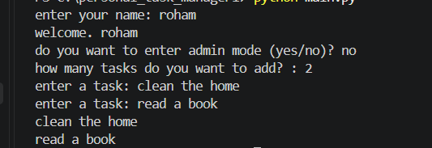

# Personal Task Manager


A simple task manager built with python for learning git & github

## Features
- add multiple tasks
- save tasks
- load saved task 
- admin mode 


## requirment 
- python
- python-dotenv


## project structure
PERSONAL_TASK_MANAGER/
│   .env.example
│   .gitignore
│   main.py
│   README.md
│   requirements.txt
│   screenshot.png
│   tasks.json
│   tasks.py


## installation
install the reqiered packages:
```bash
python -m pip install -r requirements.txt
```
## envoirخment setup
create a `.env` file in the project folder

Use `.env.example` as a template

add your admin password

```env
task_MANAGER_ADMIN_PASSWORD=your_password_here
```

replace `your_password_here` with your own admin password

## run the program
run the main file:
```bash
python main.py
```
## screenshot


## demo


